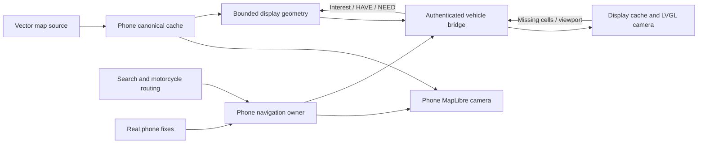

# Dynamic maps and route sharing — phase 2 plan

**Direction superseded in planning — 2026-11-05:** the user selected [removal of custom maps and replacement with notification turn guidance](turn-by-turn-plan.md). This map implementation still exists; retain this document as historical context, not the next feature plan.

Updated: 2026-11-04. **Firmware implementation complete; Android v2 and physical acceptance remain next.** At the user's explicit request to finish firmware first, its compact geometry contract is frozen independently of the still-pending phone cache/MapLibre proof. [Firmware status](navigation-phase-2-firmware.md), [mobile work packages](../mobile/docs/navigation-phase-2.md) and [exact v2 bytes](../mobile/docs/protocol.md#phase-2-navigation-extension--implemented-firmware-contract) are authoritative. Existing v1 bytes remain unchanged.

## 1. User feedback and what it establishes

The user reports successful installation/flashing and that real maps appear, but:

| Observation | Assessment / next measurement |
| --- | --- |
| About 30 KB takes 1–2 minutes to share | The present whole-region, one-command/display-ACK transfer is too slow for the intended journey. Actual MTU, effective payload rate, phone scheduling, fragment pump, encoded-UART load and ACK delays must be measured separately; the exact bottleneck is not yet established. |
| Precise permission granted but no cluster marker | Permission authorizes a source; it does not establish actual horizontal accuracy, source age, current timing anchor or map coverage. The phase 1 display deliberately hides markers failing any of these gates. Record the independent reasons rather than guessing a single cause. |
| Cannot drag display map | Current code has Follow/Area/three zoom settings, but no free camera/pointer-gesture owner. It also ties the camera center to fresh fixes. This is an implementation gap, not a user error. |
| Low accuracy and outside downloaded area | These are independent. The hardcoded central-Kolkata bounds cause missing geographic coverage; they do not cause poor GNSS accuracy. Actual accuracy may be poor even with Precise permission. The new UI must show both facts without conflating them. |
| Vehicle board shows distracting green LED | No explicit RGB/LED driver/write is present in the inspected vehicle application. Identify the actual LED, board revision and circuit before assigning a pin or claiming software can turn it off. An addressable latched LED and a hardwired power LED need different treatment. |

This is useful user bench evidence of a first map appearance, not measured throughput, position correctness, pocket continuity or bike readiness. Keep phase 1 available as a compatibility fallback while building the next path.

## 2. Target journey

1. **Open the phone app.** Location observation starts while the app is visible, once the user has granted location access. First use requests/explains permission; denial leaves manual map browsing available. This must work without a connected/paired cluster. Do not force a pairing journey before phone map access; preserve the existing pairing/radar presentation when the user chooses connection.
2. **Warm the local map.** Show cached roads immediately. A fresh fix centers the phone map and starts a bounded nearby download when online. Until there is a fix, show cached/last-viewed area with an explicit status, not a fake live point at Kolkata's center. Last-known position may be labelled last known; never persist or restore it as live.
3. **Browse.** Pan/zoom requests missing viewport cells and a modest halo, cancels obsolete work and reuses cached cells. Source zoom stops at the provider's advertised maximum; further screen zoom overscales data rather than promising additional detail. Location and camera are independent: panning does not move the location point.
4. **Search a destination.** Debounced search returns real, attributed results. Selecting a result plots a real motorcycle route from the current eligible origin; display distance/time as estimates from the route response. No hardcoded route or synthetic progress. A user-selected different start is explicitly a preview until navigation starts.
5. **Share route.** One user action starts the service-owned route/sharing session, pins the full route-corridor download and sends the minimum useful current-area package first. The cluster shows actual surrounding roads plus the route as soon as that validated working set is ready; the phone continues preparing the rest of the route in the background. Separate local-ready, cluster-ready and full-offline-ready statuses. The user need not wait for every remote corridor tile to see the first useful cluster frame.
6. **Ride / lock the phone.** The phone owns live fixes, route progress and rerouting. The cluster follows its own camera by default, receives route/position updates and prefetches its next working set. Existing instruments, warnings, Settings and lifecycle stay independent.
7. **Explore on the display.** Drag/pan/zoom changes only the display camera. A fresh current-position dot remains at its actual geographic location and can leave the viewport. Follow/Recenter returns to it. The phone camera does not jump when the display is browsed, or vice versa.
8. **Stop sharing / end navigation.** Separate controls: stop projecting to the cluster while retaining phone navigation; end navigation stops guidance and route pinning, and also ends route sharing. Disconnect/Stop sync still ends cluster sync/sharing. Explicit Stop all cancels all intents. Cached maps remain available with clear cache controls.

“Always see a dot” means a truthful current or explicitly approximate/last-known observation when the OS provides one. It cannot mean guaranteed GNSS indoors, without permission, with GPS disabled or after a stale source. “Whole route downloaded” means a verified, complete chosen map band on the phone, not an unlimited world database in ESP 32 RAM.

## 3. Map/search/routing decision

| Responsibility | Proposed choice | Constraints |
| --- | --- | --- |
| Phone map engine | Keep pinned MapLibre Flutter/native integration | Local/offline sources and styles; renderer does not calculate routes. Revisit versions only for a demonstrated API requirement. |
| Basemap / vector geometry | OpenFreeMap OSM/OpenMapTiles vector tiles | Supports ordinary viewing and bounded offline-area downloads; cache the source data used for both phone rendering and cluster conversion. No public OSMF tile scraping. |
| Destination search/autocomplete | Geoapify address autocomplete/geocoding | Real API key needed; debounce/cancel/limit requests and show quota/network failures. No public Nominatim autocomplete. |
| Route geometry / maneuvers / estimates | Geoapify Routing API, `mode=motorcycle` | Use the motorcycle profile, not an undisclosed car or moped substitute. Phone owns progress/reroute logic; API response is not a full navigation engine. |
| Embedded rendering | LVGL, simplified semantic cells + route | No raw raster screenshots, Google Maps content extraction, full MapLibre SDK or protobuf GIS stack on ESP 32. |

OpenFreeMap currently allows offline downloads bounded to 3,000 tiles or 50 MB and at most 4 parallel requests, with an identifying User-Agent. This client will conservatively enforce **both** tile and byte ceilings, stop at whichever is reached first, and use at most 2 concurrent downloads initially. Check current provider terms before implementation/release; do not split jobs to evade limits. Larger routes require a deliberately approved different provider/self-hosted source or a disclosed narrower/coarser plan, not hidden partial coverage. OpenFreeMap offers no SLA. [Official FAQ/offline policy](https://openfreemap.org/), [terms](https://openfreemap.org/tos/).

Geoapify currently advertises 3,000 credits/day and up to 5 requests/sec on the free tier, shared across API use; a request need not always equal one credit. Start with an aggregate client limit≤2 Geoapify requests/sec and a configurable daily budget below the account allowance (credit estimates are not billing proof); surface exhausted quota, never enable paid overage automatically, and confirm current terms and route-result caching/storage rights before pinning complete offline sessions. [Pricing](https://www.geoapify.com/pricing/), [routing and motorcycle profile](https://apidocs.geoapify.com/docs/routing/), [terms](https://www.geoapify.com/terms-and-conditions/).

This is the recommended personal-development stack, not a claim of unlimited free hosting. No new paid subscription, provider account, API credential or backend is created during planning. For the initial personal app, an API key can be entered/configured outside Git and stored privately on the phone. An APK-embedded build secret is extractable and is not a protected server credential. Before public distribution, decide whether to use a restricted client credential or an authenticated quota-limited gateway; a gateway/self-hosting has operational costs. Missing key disables search/routing with a setup message; cached map browsing still works.

The app must disclose that map tile requests reveal viewed areas to the tile host and route/search requests send their required origin/destination/query to the routing/search provider. No exact fix/route/request URL/key logging or default analytics. Preserve OSM/OpenMapTiles/provider attribution and offline licence notices, including on the display. Google maps/tiles are not involved. OSMF's [raster](https://operations.osmfoundation.org/policies/tiles/) and [vector](https://operations.osmfoundation.org/policies/vector/) services are not the offline download source.

## 4. Ownership and background lifecycle

Keep **one native session owner and one physical GATT owner**. Evolve the existing service instead of adding a second independent GPS/GATT implementation in Flutter:

| Intent/state | Owner and lifetime |
| --- | --- |
| Visible phone browse | Native location owner starts from visible app lifecycle after access; no BLE prerequisite. Stops when hidden unless an explicit navigation/share session needs it. A short, documented grace interval can avoid page-transition churn. |
| Phone offline-cache job | Native bounded downloader/WorkManager with an immutable area/route job; no worker starts continuous GPS. Jobs survive UI loss where Android permits, report progress and support cancel. |
| Phone navigation | Explicit visible Start navigation or Share route promotes location foreground service, with Stop navigation action. Continues while locked independently of Flutter. |
| Cluster sync | Existing BleBond/service owns saved-peer security, metadata, telemetry, retries and explicit Stop sync. |
| Cluster route sharing | Separate session/route revision and transfer intent; requires paired current peer. Stopping it does not implicitly stop phone navigation. Losing BLE hides/ages the cluster point but does not end an active phone navigation session. |
| Cameras | Phone camera is page/presentation state; display camera is display application state. Neither owns GPS, transfers or route calculation. |

On opening the app automatically warm the *phone's* map; do not automatically share private location with the cluster, select a destination or resume an old route. Continuing background GPS is tied to an explicit active navigation/share intent with an ongoing notification. Keeping prepared maps “available in background” does not require idle 24-hour GPS. No background-location permission/boot restart/battery exemption is presumed necessary.

Retain START_NOT_STICKY/no hidden restart. After process death/force-stop/reboot, reopen the app and visibly resume a saved route if desired; persisted route/cache metadata is not a live fix or an active service. Explicit Stops always win over downloads, retries and callbacks. Detaching/recreating a Flutter page or engine must not stop active navigation/sharing. Permissions, notification types and API-level foreground-start restrictions remain native and are evaluated at runtime.

## 5. Independent state model and marker behavior

Replace the combined “location/map unavailable” verdict with orthogonal immutable observations:

- `LocationObservation`: provider/permission mode, monotonic source time, horizontal accuracy, coordinates when genuinely available, course/speed quality, mock/invalid indication.
- `CoverageState`: missing/coarse/detail-ready cells, source/data revision, pending requests and cache completeness.
- `RouteState`: none/searching/preview/preparing/navigating/off-route/rerouting/arrived/paused, real route revision and progression quality.
- `TransferState`: bytes queued/sent/display-accepted, requested/current cells, verification/publication, retries and failure.
- `LinkState` and `CameraState`: independent of all above. A live BLE link does not certify any observation.

| Source/coverage | Phone and display behavior |
| --- | --- |
| Fresh eligible precise fix, useful accuracy | Filled position dot; qualified course arrow only with actual bearing accuracy≤45° and speed≥2 m/s. Accuracy ring uses the observed bound. |
| Fresh valid but approximate/poor-accuracy fix | Hollow/approximate point and dashed uncertainty circle, clear `GPS ±N m / approximate` label; no precise arrow, road snapping or confident maneuver progression. Cap huge circles to viewport with a labelled radius, never relabel the center as exact. |
| Fresh fix but missing map cells | Preserve the truthful location observation and request surrounding cells. Show `Location available · loading map here`; do not call GPS inaccurate because roads are absent. A point/grid on missing cells is explicitly a loading state, not a complete road map. |
| Stale source | After 2 s, remove live status/course/guidance; optionally retain a gray `last known · Ns ago` point for up to 10 s. After that hide it by default. A stationary fresh dot is distinct from a frozen stale dot. |
| No fix/disabled/denied/mock/future time | No invented live point; show the specific reason, keep usable cached roads and allow manual browsing. Invalid/replayed data never refreshes age. |
| User pans away | Camera enters Browse. Point remains geographically correct even when off-screen; show Recenter/off-screen indicator without drawing it at screen center. |

These are **v2 semantics**. Current v1 intentionally erases poor-quality coordinates and cannot express this approximate-point behavior safely; do not reinterpret its bytes or weaken v1 freshness checks. Preserve end-to-end monotonic timing/2 s live eligibility, current phone/vehicle/display sessions and measured clock uncertainty. Approximate points are labelled estimates, not live precise navigation. No stored timestamp provides cold-power retention; no GPS speed replaces vehicle speed.

## 6. Canonical phone cache and downloads

Use one app-private canonical raw-vector cache, indexed by provider/source snapshot + scheme + source zoom/x/y + content identity. Share it between MapLibre rendering, offline-route preparation and cluster geometry conversion. Deduplicate simultaneous requests; never download the same tile independently in two uncoordinated systems. Cache style, sprites, needed glyph ranges and licence metadata too; missing style assets cannot be called fully offline-ready.

The first integration spike must prove the exact pinned MapLibre Android resource/cache hook. Prefer its supported native resource adapter. If that cannot expose the same raw cells to conversion, select a concrete native bridge before proceeding; do not assume Flutter's renderer cache is queryable. A narrowly scoped read-only loopback tile adapter is a possible reviewed fallback, not an automatic global cleartext/network-security exception. It would bind 127.0.0.1 only, accept opaque session authorization, serve only validated map-resource paths, expose no GPS/preferences/control API, and have lifecycle/bounded-work limits. Record the chosen bridge in the mobile work doc before code expansion.

Initial app-level budgets (engineering starting points, not measured device limits):

| Budget | Proposed initial setting |
| --- | --- |
| Normal disk cache | 256 MiB LRU total including vector/derived geometry; never evict an active pinned route silently |
| Startup warm area | Current viewport plus one-cell halo, at most 64 missing source cells /8 MiB per job |
| Route corridor | ±500 m initially, with a500 m endpoint/junction buffer; continuous lower-detail coverage plus source-max detail within that band |
| Route job ceiling | ≤3,000 tiles and≤50 MB including applicable data/resources; show estimate before pinning, honor stricter current provider rules |
| Parallel network requests | 2 initially; provider maximum 4 is a hard upper ceiling, not a target |
| HTTP | Identifying User-Agent, strict HTTPS/TLS, timeouts, content/size limits, conditional requests/expiry, bounded retries/429 Retry-After; no offline polling loop |
| Motion/pan fetch | Settled viewport debounce ~250 ms, latest camera generation wins; prioritize current view before obsolete pan/route-tail work |

Honor source TileJSON scheme/min/max zoom, snapshot version and HTTP validators. Higher UI zoom may reuse a source cell. Route manifests pin a data/style snapshot where possible; unavailable snapshot cells report missing data rather than silently mixing incompatible content. The exact byte/tile estimate, cache free space and missing-resource count must be visible before claiming whole-route readiness. Reuse compatible cached cells; do not silently drop dense roads to meet a packet cap.

Cancellation stops obsolete jobs without deleting valid shared cells. Cache clear is explicit; active pinned data needs a separate stop/unpin decision. Route bundles are user-private data (destination/route can reveal intent); store privately and expose deletion controls, with no default travel history.

## 7. Search, routing and route preparation

Search coordinator: require at least 3 typed characters, debounce ~400 ms, at most one current request, cap suggestions, cancel stale query generations, bias to the visible/current area while allowing wider search, and preserve attribution. Offline: search already-cached/saved destinations only with a clear limited result set. Do not pretend remote autocomplete is offline or generate answers from a public demo endpoint.

On selection, request a motorcycle route from a fresh eligible origin, retaining endpoint IDs/coordinates, encoded geometry, real length/duration and maneuvers/source metadata. Do not equate rendering a route with a navigation engine: implement phone-side along-route progress, uncertainty-aware matching, instruction progression and off-route hysteresis. Do not reroute on one bad fix; provisional trigger is several consistent fresh fixes over~5 s outside an accuracy-aware corridor, with request cancellation and a minimum 10 s reroute backoff. Final numeric thresholds need ride-independent bench/walk evidence. Never invent road legality, speed limits, closures or traffic.

Build an immutable `RouteManifest` containing route ID/content hash, revision, profile/options, origin/destination, bounds, source/style/dataset identity, complete cell list/LOD and integrity hashes, route geometry/steps, estimated bytes and missing/download status. Capture exact selected limits rather than calling an arbitrary wide strip “sufficient.”

Share preparation has separate truths:

| State | Meaning |
| --- | --- |
| Phone route preview | Geometry/estimates received and plotted; offline cells may still be missing |
| Sharing current area | Current complete base cells + route context reach display first; phone continues corridor work |
| Cluster current area ready | Display validated/published the requested working set; not proof of full-route storage |
| Full route offline-ready | Every required phone route-band cell/style/glyph/route resource is verified and pinned |
| Partial/blocked | Network/quota/disk/provider limit left explicit missing coverage; never report Offline-ready |

A long route is stored completely on the phone within the declared job limit. If it exceeds the limit, ask for an explicitly narrower/coarser package or a different approved data source; do not quietly downgrade detail or split downloads to evade policy. While online, progressive sharing can continue with an honest partial/offline status. Without network, browse/render cached cells and the saved route; rerouting/search work only if their required data/engine exists. Initial phase 2 does not add an offline routing engine; retain the existing route and show rerouting unavailable when offline.

## 8. Display delivery: working set, not an entire-route RAM upload

The phone retains the complete prepared route corridor. The display holds a bounded current viewport + halo, next-route-area prefetch, a lightweight full-route overview and a detailed local route window. It requests missing cells for its own camera, including manual browsing away from the rider. The phone's page can be closed while serving these requests.

Use standard geographic cell identity and a defined world/camera projection, not one Kolkata-centered±20 km Scene for an arbitrarily long ride. The implemented representation uses standard Web-Mercator semantic display-cell z/x/y and extent4096, with exact latitude limits/wrap/seams/transforms in the v2 contract. Clamp upstream source zoom independently; the phone may derive requested semantic children from its canonical cached parent when overscaling. Large detailed source cells can be split into deterministic subcells; a child subdivision is a coverage unit, not silent road removal. Phone decodes/clips/simplifies source MVT, deduplicates buffered border features and produces compact display geometry/labels. The ESP 32 never parses raw provider protobuf/styles.

Route geometry is split by window/cell with a separate bounded overview; the original32-point sample-route model cannot stand in for a real long route. Use a demonstrable geometry-error/LOD tolerance and retain maneuver-critical bends; do not cut off points without a coverage/error indication. Initial limits to validate: ≤32 KiB per complete cell/object, target≤8 KiB first useful current-area bundle, ≤4 queued missing-cell requests, ≤1 MiB total map/route cache+staging+decoded working-set arena on display. These ceilings require actual PSRAM/heap/render measurements and must be advertised lower if necessary. Do not allocate old v1 arenas plus new v2 maximums blindly.

Independent content identity (`dataset/style/schema + cell/LOD + SHA 256`) and per-connection transfer identity allow HAVE/NEED negotiation. Identical validated cells/route sections survive reconnection in RAM and need not be resent after full content-hash confirmation in the new context. No map flash/NVS writes or assumed SD card. Cold display power loss empties its RAM cache; the phone retains disk cache and restores the initial working set first.

Each cell activates atomically after length, integrity, limits and geometry validation. Several complete compatible cells may publish progressively; a partially received cell never draws. Keep old compatible visible cells until replacements are complete. Do not clear all roads for a route-progress message or a failed unrelated tile. Keep route revisions separate from cell updates; never attach new maneuvers to old geometry. Reroute swaps the minimum complete new current-area/route revision atomically, then fills its halo.

## 9. Transfer performance and transport decision

Start with measured BLE + current 115200/8N1 UART, not immediate Wi-Fi/pin/baud changes. At8N1 the UART has 11,520 raw bytes/sec; the existing bulk ceiling is 4,096 **encoded UART bytes/sec**, not application map throughput. Legacy input/status/metadata, framing/escaping, GATT overhead, end-to-end stop-and-wait ACKs and pacing consume additional time.

Code observations explain plausible avoidable latency: one outstanding map command, ≤200 payload bytes at MTU 247 or 53 at MTU 96, a vehicle fragment pump tied to 20 ms acquisition turns, a display ACK round trip per command, then≥67 ms app pacing rounded by its scheduler. These are observations, not measured attribution of the user's1–2 minute result. Record actual MTU first.

The implemented v2 bounded pipeline uses: display-advertised byte/object credits and a window 1..4, cumulative accepted offsets/bitmap or missing-range ACKs, retransmit only missing chunks, retain one ATT procedure at a time, and allow multiple **display-pending** chunks after ATT responses. BLE Write Without Response is optional only if explicitly negotiated, paced and buffer-credit protected; never infer reliability from it or use unbounded queues. Resume only verified content/ranges in the correct boot/session/content context.

Move fragment draining to the existing UART TX worker/pump with bounded queues rather than one fragment per acquisition turn. Preserve critical frame priority, latest location/time control, then map bulk. Keep the existing bulk limit until traces prove more headroom; a baud increase requires separate physical acceptance. Optimize framing only after proving map bytes cannot masquerade as legacy control/input frames, even on corruption/resynchronization. Do not replace the present magic-safe escaping with a faster generic encoding without that proof. CRC/security/session checks stay intact.

Provisional acceptance targets, measured from an already secured/capability-ready link and a prepared phone cache, excluding internet fetch:

- First useful current-area road/route bundle≤8 KiB: visible within 5 s at MTU≥247.
- Identical 30,066-byte comparison payload: display accepted/active within 20 s at MTU≥247,45 s at MTU 96, with no input/warning/metadata regression.
- A camera drag uses already cached cells immediately; missing areas stay visibly pending, latest viewport wins and no hidden point follows the finger.

These are design targets, not promises. Report download, conversion, ATT, UART, validation and publication separately. If BLE/UART tuning cannot meet the accepted targets, decide a second bulk transport deliberately. Phone→vehicle Wi-Fi alone does not remove the vehicle→display UART bottleneck. A Wi-Fi stage would need saved-peer-authorized provisioning, vetted authenticated encryption/certificate binding, Android local-network selection while internet fetch keeps using mobile/default network, bounded transfer/recovery and power/coexistence measurements. It is **not** part of the first implementation commitment. Display-radio ownership or physical UART changes require an explicit architecture/hardware decision; do not bypass the vehicle owner casually.

## 10. Independent display interaction

Introduce display-owned `MapCamera {center, zoom, follow/browse, projection/world-wrap state}`. Pose, camera and route progression are different values. A drag immediately selects Browse; location packets continue updating the geographic point but never recenter this camera. Follow is explicit and remains latched until a new manual gesture; no surprise snap-back timer. Zoom preserves the world point under the gesture/anchor within bounded levels.

Use LVGL owner-thread press/move/release gesture handling on the map content rectangle only. Screen-space deltas convert through the camera scale; a small movement threshold distinguishes tap from drag. Preserve warning/instrument/settings/footer hit targets. Primary controls: Follow/Recenter, Area/Route overview, +/− and Back; physical focus/select/Back must remain available. Physical panning uses explicit Pan mode/directional actions, not newly guessed button holds. If the current touch adapter exposes release-only coordinates, extend the adapter to bounded press/move/release samples before claiming drag support.

Do not promise pinch until the actual panel/touch adapter supplies a verified multi-contact stream; +/− is required regardless. Clamp zoom to supported geometry/LOD. Render current route, other roads, available/cached/missing cells, actual/approximate/stale point styles, scale and attribution consistently across themes. The phone may render richer cartography; “same map” means the same geographic coverage, source identity, route and pose, not an identical 800×480 screenshot. First iteration stays north-up; heading-up is separate optional work.

## 11. Vehicle LED off requirement

User requirement: no distracting green/status RGB on the vehicle board during normal use. Before implementation, record actual board model/revision and identify which LED is illuminated. Inspect schematics/board markings and test whether it is power-wired, simple GPIO or addressable RGB; no guessedGPIO 48/GPIO 38/active polarity. The original vehicle source had no RGB output; the implemented 7Semi profile now sends an OFF frame at application start using the manufacturer-documented GPIO48.

For a verified controllable LED, add a board-profile-owned driver that sets OFF early at application start and keeps it off through pairing, transfer, normal operation and faults. Choose the correct protocol/active level and verify no acquisition/UART/input pin conflicts. No blinking/status color feature is requested. Check power cycle as well as soft reset/latch retention. Firmware cannot guarantee ROM/bootloader behavior without evidence. For a hardwired power LED, document that software cannot disable it; a separate user-approved physical remedy is required rather than an invented firmware fix.

## 12. Wire change boundaries

The [phone protocol guide](../mobile/docs/protocol.md) remains the exact-byte authority. Phase 2 requires a separately discoverable/versioned extension; do not add unknown bits to strict c013 or reinterpret c016–c018/v1 bodies. Old app/new firmware and new app/old firmware retain metadata/telemetry and explicit limited-v1 behavior.

Required semantic messages for v2: capability/session; navigation/route manifest and revision; source observation with explicit limited-quality coordinates; view interest/HAVE/NEED/cancel; object begin/data/verify/activate; bounded flow credit and cumulative progress; current route-window/maneuver/progress; Stop sharing/end navigation. Status separates location, coverage, route revision, transfer and camera; display UI navigation never changes phone routing merely by panning.

Before Android implements the channel, freeze exact UUIDs, byte offsets/endianness, enum/reserved handling, maximums, source/session/ordering/time rules, request priority, hash/CRC coverage, credit accounting, timeout/retry/cancel/resume and normative positive/negative vectors in that guide. The firmware can initially exercise these through a paired desktop sender and host preview. Exact v2 byte layouts are now implemented in the protocol guide. The user requested firmware-first completion; phone raw-cache/renderer integration remains a mobile proof, not an unspecified firmware channel. Firmware uses an independently defined bounded semantic-cell schema and the preserved safe framing.

## 13. Implementation sequence and completion gates

| Stage | Deliverable / exit gate |
| --- | --- |
| P0 diagnose baseline | Numeric transfer stage timings, actual MTU/throughput/queues/input/UI gaps; independent fix accuracy/age/permission/anchor/coverage; LED identity; RAM and touch capability; provider/raw-cache integration spike scoped for the subsequent Actions prototype. No data/privacy logs. |
| P1 firmware foundations | Verified LED-off implementation where controllable; camera independent of pose; drag/+−/Follow and bounded working-set rendering; priority TX-pump improvements with old protocol unchanged first. |
| P2 v2 contract + firmware | Implemented firmware-first at user request: compact cells/projection, twelve-slot bounded cache, overview/windows/revisions, versioned c019–c01b, credits/pipeline/full-hash reuse/requests/reset semantics and static vectors. Affected builds/manual host renders precede physical radio/load acceptance. Mobile proves its source/renderer adapter against this contract. |
| P3 mobile location + live map | Native browse/navigation/share lifetimes independent of BLE; real nearby source/cache on app open, MapLibre bridge spike resolved, quality/coverage split, pan/zoom fetch, no static-city dependency. |
| P4 mobile search + route cache | Configured provider/key, motorcycle route preview, complete bounded corridor manifest/cache and offline-ready accounting; correct no-network/quota/storage behavior. |
| P5 integrate sharing | Minimal current working set first, route overview/window, independent display requests, reuse/resume/cancel/reroute and honest progress; validate performance targets/coexistence. |
| P6 user physical acceptance | Latest target phone normal text, light/dark and permission/unavailable states; firmware 800×480 both layouts/themes; no small-screen/2× phone checks; no local app builds or automated suites. |

App code/APKs are built by GitHub Actions after user-controlled commit/push; do not attempt local Android builds, SDK/Studio installation or ad-hoc native compilation. User installs with the existing ADB helper and performs manual testing. Firmware builds, static/runtime diagnostics and permitted host development previews remain separate. The original planning turn made no code/flash/account/Git changes. Current firmware implementation/evidence is recorded separately; physical flashing and Android acceptance remain user bench work.

## 14. Manual acceptance cases

- Open app without cluster, allow/deny/approximate permission, GPS off, no fix, poor accuracy outdoors/indoors; cached map works and no fake live point appears. Valid coordinates outside the former Kolkata bbox get nearby data rather than a permanent coverage error.
- Rapid pan/zoom, return to previous areas, provider source-max zoom, large/dense cells and cancel; bounded network/disk/RAM and visible missing detail. Airplane mode proves claimed offline resources, not just a cached background color.
- Real motorcycle route preview; distance/ETA labelled estimates; Share shows current roads/route quickly, while full-corridor completeness is separately measured. Route-limit/quota/disk/download failures are explicit.
- Phone and display pan/zoom independently. A live dot remains at its geographic position; display Browse never changes route origin/destination or recenters from incoming fixes; Follow and Back work physically/touch.
- Loss/reconnect/reset at every preparation/transfer/activation stage; old revisions/IDs/duplicate/conflicting bytes never activate; old compatible complete cells stay visible. Current point/data age remains truthful.
- Off-route with good vs poor fixes, reroute revision swap, no network reroute, cached-only camera browse and roaming outside route band; no repeated route requests from jitter.
- Notification Stop sharing vs Stop navigation vs Stop sync, UI/engine recreation, process death/relaunch; exact intended work stops/resumes and cached files never become a live route automatically.
- Measured 30 KB comparison and initial bundle performance, source/metadata/UI gaps, heaps/stacks/PSRAM/queues/radio coexistence; warning priority and both 2.00 s lifecycle sequences unchanged. Verify the identified vehicle LED remains off across states where software controls it.

## 15. Decisions required before the corresponding implementation stage

1. Confirm the recommended OpenFreeMap + Geoapify motorcycle/search stack and obtain/configure the user's provider key before P4; no paid tier assumed.
2. Identify the actual green LED circuit/board revision before LED code. Do not guess a GPIO.
3. Prove the canonical raw-tile cache/MapLibre resource bridge before claiming mobile offline integration; encode to the now-implemented v2 schema. Measure actual board heaps/stacks/rendering/throughput before accepting performance targets.
4. Agree provider-bounded corridor limits and the explicit over-limit fallback. Full-route phone storage and bounded display cache are intentional; an entire arbitrary route will not fit in display RAM.
5. Decide Wi-Fi/baud/hardware changes only if measured v2 BLE/UART results miss the accepted targets. They are not prerequisites inferred from a slow 30 KB v1 run.
