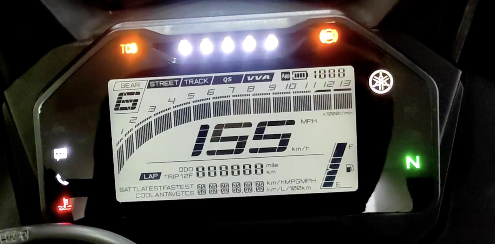

# Implementation status and plan

Updated: 2026-10-19. Status: native dashboard, Appearance preferences, Bluetooth and Wi-Fi UI/demos implemented; Navigation, hardware firmware and integrations pending.

## Current implementation

| Feature | Current state |
| --- | --- |
| Dashboard | Street centered speed; Track centered current/best lap with secondary speed; equal section heights; Midnight/Daylight |
| Instruments/assets | Chakra Petch Bold Italic numerals, Inter labels/RPM, Barlow clock; 16 MDI symbols; fractional eight-piece fuel gauge and 16% reserve cue |
| Ride pages | ODO/Trip 1/Trip 2; coolant, Track, real-time consumption, average consumption, average speed, TCS, unidentified placeholder |
| Settings | Four-category home, reversible 280 ms compact-speed transition, sequential non-touch focus and access below valid 20 km/h |
| Appearance | Theme preview/Apply/Cancel and versioned host restart persistence; one Instrument design |
| Bluetooth | Simulated pairing/connect/cancel/disconnect/confirmed Forget and failed/unknown states |
| Wi-Fi | Simulated bounded network list/search/connect/disconnect/confirmed Forget; explicit pending-credentials notice |
| Lifecycle | R15 Light Signature; boot 3,000 ms, shutdown 2,000 ms; immediate valid urgent-warning reveal |
| Host optimizations | Persistent RAII components, changed-field updates, bounded formatting, role-specific font/icon subsets, deferred covered instrumentation, persistent readout text buffers, dirty-driven SDL presentation and zero settled redraws |
| Pending | Navigation/Maps feasibility, clock editor/source, real trip/lap calculations, firmware NVS, UART codec, real radio/vehicle adapters, panel/power/hardware verification |

Host odometer, trips, laps, economy and average speed are fixed samples; TCS mutation and radio flows are simulator-only. Only confirmed theme/design persist. UI warning thresholds and the Settings speed gate are user-selected behavior, not verified Yamaha limits or proof of safe use while moving.

## Sequence

| Stage | Deliverable | Exit evidence |
| --- | --- | --- |
| E0 — Design | Architecture, style guide, responsibility map and unresolved decisions | User reviews plan; exact board identity, vehicle MCU and Maps scope tracked |
| E1 — Reproducible baseline | Define deterministic UI scenarios; vendor board example; pin toolchain/dependencies | Host test baseline established; known vendor example builds; schematic/revision and flash/PSRAM/ports match actual board |
| E2 — Shared state and host LVGL | Portable quality/state/input model, LVGL host window and tokens | Same LVGL sources build on host; state/format/navigation tests; no LVGL/IDF dependencies in shared model |
| E3 — UI implementation | Street/Track, both themes, instruments, warnings, menus and lifecycle animations | Deterministic 800 x 480 captures against specified geometry; visual review; behavior boundaries pass |
| E4 — Display firmware | Minimal board port, fonts, settings, demo source and diagnostics | Firmware fits actual flash; RGB test and demo UI run on panel; measured memory/render/latency; no artifact/leak growth |
| E5 — UART bench | Reviewed protocol specification, codec, synthetic sender, display receiver | Golden vectors; truncated/oversized/corrupt/version/reset/overflow tests; cable loss, restart and stale signal behavior |
| E6 — Vehicle MCU | Verified input adapters/calculations and bounded Wi-Fi/BLE services | Bench sources match observations; radio load cannot starve acquisition; semantic input and command tests |
| E7 — Passive bike observation | Reviewed electrical interface and measured mappings | OEM retained; listen-only verification; compare logged observations to independent references; no speculative decode |
| E8 — Replacement evaluation | Power/boot/reset/fault, independent tell-tales and mechanical/environmental assessment | Explicit reviewed evidence before replacement; software parity alone is insufficient |

E2/E3 host work can proceed before delivery. E4 compile preparation can overlap, but board bring-up is a prerequisite to claiming display readiness. E5 can begin with synthetic UART data without Yamaha decoding. Custom moving-map navigation is a separate feasibility gate; it is not hidden inside E6 BLE work. The [companion implementation plan](../mobile/docs/implementation-plan.md) tracks the Android-first Flutter app, Mac bridge and future iOS work.

## Next implementation gates

The host baseline, dashboard, portable presentation/input, settings and applicable host optimizations are implemented. See [resource accounting](resource-budgets.md) for current measurements and [settings](settings.md) for service boundaries.

1. Confirm delivered board revision, schematic/factory example, UART/programming conflicts and vehicle MCU.
2. Reproduce the matching vendor example and establish a minimal panel target with compatible pinned dependencies.
3. Measure actual flash/partition fit, internal SRAM/PSRAM, driver buffers, timing and scanout behavior before claiming display readiness.
4. Plan Navigation and clock controls after their service/time-source contracts are reviewed; preserve the approved dashboard and lifecycle visuals.
5. Review the versioned UART contract and vehicle/radio persistence ownership, then implement and fault-test real adapters. Host theme/design persistence is already implemented; ESP32 NVS is pending.

No empty firmware scaffolding, unused queues or speculative board pins substitute for these gates.

## Test strategy

- Portable unit tests: numeric/quality validation, stale deadlines, unit conversion, formatting, calculations, action routing, schema migration.
- Codec tests: all split points, multiple frames/read, garbage and boot logs, max lengths, CRC corruption, missing fields, versions/enums/ranges, sequence wrap, duplicate/out-of-order frames, reboot/session and source age.
- Host LVGL tests: important widget state and navigation, deterministic render scenarios at 800 x 480. Use the specified behavior and meaningful boundary cases.
- Target tests: RGB color bars, rotation/stride, PSRAM, panel timings, flush completion, fonts, settings writes, UART stress, brownout/restart simulation and independent MCU boot order.
- Load/soak: worst-case RPM/fuel/turn/shift updates with menus and settings writes; vehicle radio load; log frame times, latency, heap largest block, stack margins, queue high-water marks and loss counters.
- Vehicle validation: passive only initially; track every signal's evidence and compare actual readouts. Bench and host success never count as bike verification.

Performance objectives are provisional in [architecture](architecture.md). Establish representative runs and measured budgets before optimizing or promising frame rate/startup time. Do not gate correctness on internet services or a phone connection.

## Open decisions and missing evidence

| Item | Needed before |
| --- | --- |
| Elecrow product-family URL supplied; delivered PCB revision, schematic and matching factory archive still needed | Board pin/timing/UART selection |
| Vehicle ESP32 model and available peripherals | CAN/input/radio task implementation |
| User's measured harness inventory | Any bike adapter; record connector view, pin numbering, conditions, polarity, range and uncertainty |
| CAN physical/protocol confirmation | Controller/transceiver choice; no guessed IDs/bitrate |
| Custom moving map selected on 2026-10-21; embedded map/bandwidth/provider feasibility and phone-service capabilities still needed | Promising final feature coverage |
| Physical control source and event semantics | Hardware navigation; touch remains optional |
| Real versus calculated odometer, retention and calibration | Persistent vehicle values |
| Clock source, retention and disconnected behavior | Hardware clock editor/restore action |
| Warning unknown/failure behavior and independent indicators | Replacement evaluation |
| Image size/partition fit and update strategy | OTA or dual-image claims |

## Current verification

Nine host suites pass: model/lifecycle, Light Signature, presentation/input, desktop input, Bluetooth, Wi-Fi, preferences, typography and LVGL rendering. The render suite captures 294 scenarios, including both layouts/themes, signal boundaries, warnings/unavailable states, settings transitions, radio progress/failures and interruption. It rejects LVGL warnings and redundant flushes for settled screens. Repeated construction/destruction, cached-versus-fresh rendering and exact dashboard restoration are checked.

No firmware has been flashed, and no UART, panel, retained-power or bike verification is claimed. Run the [preview and verification commands](getting-started.md) after changes; record actual hardware evidence separately.

## Hardware and release gates

- Confirm actual board revision, panel pin mapping, timing, PSRAM and UART/console conflicts using matching vendor resources.
- Record harness measurements with connector orientation, pin numbering, conditions, voltage, polarity, loading and uncertainty. Do not infer protocol from wire labels alone.
- CAN bus lines connect through suitable bus protection/transceiver circuitry. Isolation requires a designed signal/power barrier; generic optocouplers in CAN H/L are not an approved interface. Verify bus type, termination and passive controller operation.
- Validate each discrete/analog/pulse input separately. No direct vehicle voltage to MCU GPIO; board power input rating does not establish GPIO tolerance.
- Verify regulated supply under startup, cranking, key-off hold-up, rapid cycling and hard power loss. Shutdown artwork requires retained supply; review [power lifecycle](power-lifecycle.md).
- Confirm independent warning strategy and failure behavior if either MCU or UART stops. Two MCUs alone do not provide safety certification or fault independence.
- Measure internal SRAM, PSRAM, flash/image fit, task stacks, queues, render times and radio/acquisition contention under representative load.
- Review real odometer provenance, persistence atomicity/wear and reset permissions before storing vehicle-owned data.
- Test boot/shutdown animation timing and urgent-warning interruption on host and panel. Record total key-on latency separately.
- Keep OEM functionality during initial passive testing. Do not transmit to a real vehicle without an explicitly reviewed active-test phase.

Software, bench, hardware and bike verification are separate evidence levels. No regulatory compliance or production readiness is currently claimed.

## OEM requirements and evidence

The supplied OEM photograph is a functional reference, not proof of available signals or simultaneous operating states.

| Function | UI requirement | Vehicle evidence |
| --- | --- | --- |
| Speed/RPM | Readable speed, continuous 0–13 RPM scale | Exact sources/calibration pending |
| Gear/neutral | Gear-first header and neutral tell-tale | User reports harness progress; mappings pending |
| Fuel | Eight slanted segments, percentage and pump icon | Calibration pending |
| Turn/high beam | Separate turn arrows and beam pictogram | Detailed measurements pending |
| ABS/engine/TCS/coolant warning | Distinct visible tell-tales with unknown-state handling | Actual semantics pending |
| QS/VVA | Badges when supported/active | Real support/rules pending |
| Phone/battery/call/message | Separate phone status; never confuse phone and bike battery | Connectivity services pending |
| Odometer | Actual verified value or unavailable | Provenance/retention pending |
| ODO / Trip 1 / Trip 2 | Vehicle-side calculation with explicit units and reset semantics | Calibration/retention pending |
| Laps | Current/latest/fastest, monotonic timing | Application implementation pending |
| Bike battery/coolant | Values and independent signal quality | Electrical sources pending |
| Economy/average speed | Explicit unavailable until supported | Inputs and OEM semantics pending |
| Clock/date | Validated editor and explicit time-source quality | Retained clock source pending |

Street/Track are display layouts, not ECU commands. Midnight/Daylight are presentation themes. Keep lower information pages and physical settings navigation. User-selected visual warning thresholds are in the [style guide](lvgl-style-guide.md); they are not verified Yamaha limits. Factory menu ordering, economy units, indicator artwork and independent physical tell-tales require verification.

User observation (2026-10-19): OEM boot approximately 3 s. Info list: coolant, Track toggle, real-time fuel L/100km, average fuel L/100km, average speed km/h, TCS toggle, unidentified final entry. The final entry and consumption/average measurement windows need identification. Host presentation follows this order; no OEM protocol/calculation equivalence is claimed.
