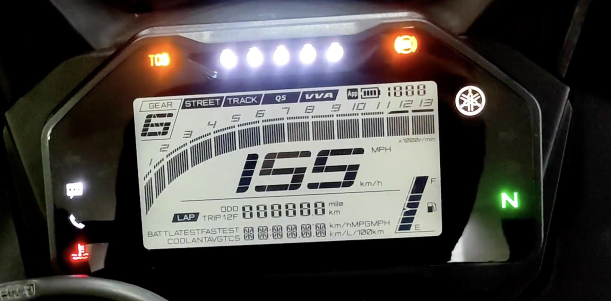

# Instrumentation and OEM verification inventory

Baseline: 2026-10-18. The supplied OEM photograph is a functional reference, not proof of available signals or simultaneous operating states.

| Function | UI requirement | Vehicle evidence |
| --- | --- | --- |
| Speed/RPM | Readable speed, continuous 0–13 RPM scale | Exact sources/calibration pending |
| Gear/neutral | Gear-first header and neutral tell-tale | User reports harness progress; mappings pending |
| Fuel | Eight slanted segments, percentage and pump icon | Calibration pending |
| Turn/high beam | Separate turn arrows and beam pictogram | Detailed measurements pending |
| ABS/engine/TCS/coolant warning | Distinct visible tell-tales with unknown-state handling | Actual semantics pending |
| QS/VVA | Badges when supported/active | Real support/rules pending |
| Phone/battery/call/message | Separate phone status; never confuse phone and bike battery | Connectivity services pending |
| Odometer | Actual verified value or unavailable | Provenance/retention pending |
| ODO / Trip 1 / Trip 2 | Vehicle-side calculation with explicit units and reset semantics | Calibration/retention pending |
| Laps | Current/latest/fastest, monotonic timing | Application implementation pending |
| Bike battery/coolant | Values and independent signal quality | Electrical sources pending |
| Economy/average speed | Explicit unavailable until supported | Inputs and OEM semantics pending |
| Clock/date | Validated editor and explicit time-source quality | Retained clock source pending |

Street/Track are display layouts, not ECU commands. Midnight/Daylight are presentation themes. Keep lower information pages and physical settings navigation. User-selected visual warning thresholds are in the [style guide](../lvgl-style-guide.md); they are not verified Yamaha limits. Factory menu ordering, economy units, indicator artwork and independent physical tell-tales require verification.

User observation (2026-10-19): OEM boot approximately 3 s. Info list: coolant, Track toggle, real-time fuel L/100km, average fuel L/100km, average speed km/h, TCS toggle, unidentified final entry. The final entry and consumption/average measurement windows need identification. Host presentation follows this order; no OEM protocol/calculation equivalence is claimed.
