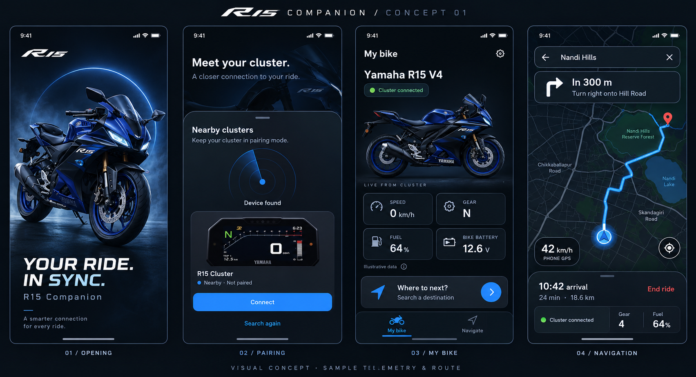
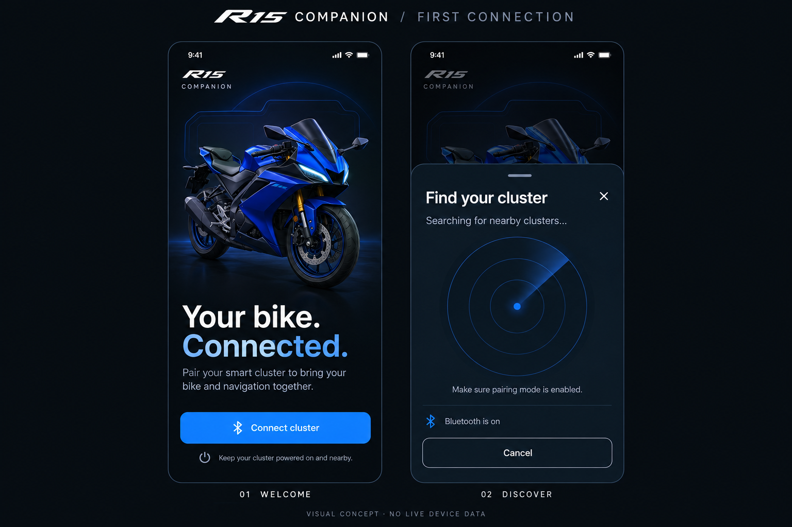

# Companion architecture, status and approved UI

Updated: 2026-11-02. Android pairing/reconnect, Concept 01 Home/bottom navigation and authenticated phone metadata are implemented. Native foreground ownership and c013–c015 telemetry integration are implemented in source; latest APK packaging and physical B1/B2 background/telemetry acceptance remain pending. GPS/navigation/maps and native iOS integration remain pending. Read [implementation plan](architecture.md#current-status-and-roadmap) and [background work plan](background-sync.md) for the next task; approved visuals remain in [visual design](architecture.md#approved-visual-design).

## Ownership and dependency boundaries

```text
OS services + reviewed map/routing provider
  -> Phone service/session: GPS, routes, metadata, connection
  -> Vehicle ESP32: authenticated radios, bounded validation/forwarding,
                    acquisition/calculations/physical inputs
  -> Display ESP32: normalized state/cache -> presenter -> one LVGL owner
```

Flutter/Dart shares UI/domain logic; Kotlin/Swift own platform-specific services. Phone owns search/routing/rerouting and permitted map preparation, notifications and media. Vehicle owns radios and acquisition, not the routing engine. Display owns presentation and map rendering/cache. Retain two MCUs; no Android Auto/CarPlay receiver or extra processor is assumed. A real surrounding-road moving map, route and position remain the product goal; arrows alone are an intermediate milestone. Provider rights and embedded bandwidth/render feasibility must be established first. Audio stays phone/headset.

Independent Flutter/Gradle/Xcode and CMake/ESP-IDF builds permit independent releases. Protocol compatibility/capabilities must be explicit. Domain values carry quality/source/units and import no Flutter/OS SDKs. Widgets render immutable state and emit intents; application owners coordinate bounded cancellable work; adapters own packets, provider APIs, permissions and storage. Use constructor composition, not a service locator/event bus or unused repository hierarchy. Add feature folders and dependencies only when consumed. Measure/coalesce changing observations rather than rebuilding the entire app/map.

`lib/app/` owns composition, selected page and theme; `features/phone/` contains connection/access domain, application, data and presentation; `features/home/domain/bike_telemetry.dart` contains independent quality-bearing bike readings. `CompanionHome` owns tabs, not GATT. Only real Available gear from current authenticated telemetry populates Home; speed/RPM/fuel/bike voltage remain Unsupported in this firmware. Startup's cancellable 900 ms branding timer owns no radio work. Fonts are local Inter Medium/SemiBold and Chakra Petch branding with OFL licenses; mobile copies stay synchronized with root font sources.

## Current native lifetime and target ownership

`ClusterSyncService` is the started Android `connectedDevice` foreground service and owns one application-context `BleBond`, one reconnect timer and notification/Stop action. `MainActivity` binds for semantic commands/current snapshots; observer detach, UI disposal and Activity destruction leave active sync running. Dart `BleConnection` no longer schedules reconnects or disconnects on background/disposal. `PhoneMetadataSource` still samples current name/battery/time at dispatch with 30-second/event cadence, 1.1-second minimum spacing and independent 90-second expiry.

Discovery, enrollment, MTU, metadata, capabilities, CCCD, timed telemetry baseline and optional health reads share one serialized ATT owner. Callback GATT/characteristic identity, boot/connection tokens, CRC/fields, unsigned ordering and conservative monotonic ages gate readings. One pending/latest notification is retained; no counter actions are replayed. Service-change invalidates refs before serialized rediscovery; missing callbacks close the old GATT before recovery. Native retries use 1/2/4/8-second rounds plus 30-second cooldown and preserve authentication/remote-termination stops. Explicit Stop persists until deliberate Connect; bonds remain.

The service is `START_NOT_STICKY`, without boot/background-start exemptions or a permanent wake lock. Reopen in the foreground after process death, Active apps Stop, Settings force-stop or reboot; ordinary UI background/recents removal does not request a stop, with OEM behavior still requiring acceptance. [Implemented policy and timing limits](background-sync.md#implemented-android-policy-and-remaining-acceptance) are authoritative. M1/M2 source integration is not B1/B2 acceptance. A future navigation engine still needs service-owned lifetime independent of Flutter pages.

`PreviewSession` is a separate Mac BLE-discovery/TLS session, with protected trust and bounded IPC to the simulator; it is not physical ESP32 application authorization. [Protocol](protocol.md) defines physical c011/c012; [development](development.md#mac-preview-adapter) defines c001/c002 and bridge operations. Never combine their success flags into feature readiness.

## Rider journey and truthful state

Startup checks required BLE permission/radio access and rechecks on foreground resume. Android 12+ uses Nearby devices; older supported Android uses Location permission/services for scans. Requestable denial offers retry, permanent denial opens Settings, disabled radio offers the OS enable flow. GPS/notification/media permissions are requested only with their implemented features. Revocation invalidates current capability; cached grants do not authorize operations. iOS access is separately pending.

First-time riders see the approved bike landing and real bounded radar. Only case-sensitive `R15 Cluster` prefix matches are shown, all retained results together with stable decorative placement, fitted full two-line names, pinch zoom and reduced-motion behavior. Positions do not measure proximity. Selecting a result stops scanning and begins the actual OS numeric comparison; name/address/advertisement match is not trust. Keep one real GATT after successful pairing.

Saved riders enter My bike Home: truthful connection status, bike art, real Available gear and honest speed/fuel/bike-voltage placeholders and Where to next. My bike/Navigate bottom tabs retain the same connection owner; status/settings opens the connection page and Back restores the previous tab. Navigate currently explains pending services. No fake map or sample 0/N/fuel/voltage is permitted in normal runtime. Light/dark, small screens, large text and reduced motion stay supported.

Keep saved bond, live BLE, authenticated endpoint acceptance, field freshness, telemetry readiness and navigation readiness distinct. Disconnect/Stop preserves trust; app Forget clears the selection and explains Android plus cluster cleanup. Partial/asymmetric trust failures remain visible. Do not silently re-pair, erase trust or promise remote Forget.

Future ride: select a phone destination -> reviewed route overview -> Start ride while visible -> foreground location/session work continues with the screen locked -> explicit End ride. No initial cluster keyboard. A navigation view retains speed/gear/warnings and non-touch Back controls. Warnings outrank bounded optional banners; stale GPS/route, BLE loss and Wi-Fi bulk loss are independent. No phone dependency may block instrumentation or either 2.00-second lifecycle sequence. Settings access remains unrestricted per current user instruction, not old speed-gate proposals.

## Security, privacy and release

BLE bonding does not authorize every future application operation. Preserve actual OS numeric comparison and firmware authenticated Secure Connections. Enrollment c011 is deliberately untrusted display text; c012 is authenticated transient metadata, not navigation authorization. Bind future sessions/capabilities and any Wi-Fi peer to reviewed trusted identity; do not invent crypto or treat UART CRC as authentication. Use maintained libraries. Vehicle NVS is currently not physically protected/encrypted; no production secret-at-rest claim is made.

Android stores bond keys. App selection persists only bounded locator/name hints; display preferences hold no credentials. Mac preview trust uses Android Keystore-backed AES-GCM/no-backup storage and Mac Keychain. Bootstrap/CA/credential distribution is development-only. No accept-all TLS, global cleartext exception, keys/tokens/signing files, private device identifiers, phone contents or route history in Git/logs. Log bounded numeric state/status/age/counters. Provider keys require restrictions/quotas; mobile bundles cannot keep embedded secrets confidential.

Permissions/data are least-privilege. Notifications and previews are separately opt-in; no history or unrelated content collection. Clear transient session content on disconnect/forget and define TTL/cancellation before enabling it. Optional denial must not block unrelated features. No cloud account/backend/analytics is required for the local companion; provider requirements remain separate. No app path controls vehicle functions. Native iOS BLE/location background, ANCS/AMS and supported media/notifications need separate capability assessment and real-device evidence; Flutter cannot grant parity.

Pin Flutter/native tools/dependencies, commit locks/generated project source and keep SDKs/builds/captures local. App IDs are provisional; release signing/store ownership remain pending. Before distribution review enrollment/revocation/replay, malformed/flood input, transport/at-rest security, backup exclusions, licenses/privacy disclosures and signed build ownership. Debug signing is never production signing. Manual checks/builds/static analysis apply during this phase; automated suites remain deferred by RULES.md.

## Current status and roadmap

Updated: 2026-11-02. This is current status, not a chronological changelog. [Development](development.md#current-evidence-and-remaining-checks) holds concise evidence. No automated tests/suites may be authored/restored/run until requested; use formatting/static analysis, affected builds and real-device manual checks.

### Implemented baseline

| Area | Actual state |
| --- | --- |
| Foundation | Pinned Flutter/Android and generated iOS shell; explicit composition and local fonts/artwork |
| Access/discovery | Android startup/resume permission/radio checks; real exact-prefix radar with bounded scanning/results/cancellation |
| Pairing/link | OS numeric comparison, enrollment name, one retained GATT, saved selection, native background retry/cooldown, explicit Disconnect/Stop/Forget-selection |
| Home | Approved Concept 01 My bike/Navigate tabs, bike art, truthful connection; independent quality-bearing readings; real gear and Unsupported measurements |
| Phone metadata | Authenticated c012 name, actual phone battery, UTC/local offset; MTU/callback ordering, retries, periodic/event coalescing and expiry |
| Background/telemetry | Foreground connection owner, notification/Stop, strict capability/telemetry/health decoding and timed expiry; APK packaging and B1/B2 pending |
| Mac preview | Separate BLE discovery/TLS application session with protected saved trust and host IPC |
| Not implemented | Automatic process recovery, GPS/route/map provider, embedded navigation delivery, broader phone services, native iOS integrations |

Core Android first pair/name/live-link, saved reconnect after board power cycle, Disconnect/Connect, relaunch and connected metadata are physically user-confirmed. Extended faults, locked-screen runtime, performance/energy and iOS are separate gates. Old completed handoff instructions are consolidated into [protocol](protocol.md); they are not upcoming tasks.

### Next work in order

| Gate | Deliverable | Completion evidence/dependency |
| --- | --- | --- |
| M1 / joint B1 | [Background BLE continuity](background-sync.md#m1-implement-background-ble-continuity-first): service owns existing GATT/metadata, notification/Stop, native background recovery | Current firmware suffices; 60-minute untethered locked-screen run, Activity recreation, loss/recovery and Stop behavior; no pairing/UI regression |
| M2 / joint B2 | Consume the supplied c013–c015 firmware capability/telemetry/health contract in the M1 service | App decoder/subscription/expiry are source-integrated; APK packaging and physical delivery/load checks are pending |
| M3a | Select map/routing provider and validate licensed embedded delivery plus two-MCU bandwidth/cache/render feasibility | Primary provider docs, costs/keys/attribution/offline limits and actual target measurements before SDK commitment |
| M3b / joint B3 | Search, destination/route overview, active location/navigation independent of UI, reroute/arrival/End ride and reviewed cluster transfer | M1/M2 foundation plus provider/firmware contract; real locked-screen GPS and display behavior, stale/cancel/offline recovery and measured energy |
| Later | Supported notification/media features, separate iOS implementation and release evaluation | Scoped permission/accessory contracts, independent native device evidence and explicit signing/distribution authorization |

M1/M2 source integration is ready for APK packaging and joint acceptance; firmware developer follows [F1](../../docs/background-sync.md#work-independently-f1-continuity-baseline). Current M2 uses the supplied frozen firmware contract; later M3 wire changes require coordinated protocol review, not mobile-side invention or unrequested firmware changes. The initial firmware milestone may need no source change. Source integration, APK packaging and physical acceptance are separate evidence gates.

### Preserve at every stage

Read mobile/AGENTS.md, [architecture](architecture.md#companion-architecture-status-and-approved-ui), [visual design](architecture.md#approved-visual-design), [protocol](protocol.md) and the current milestone plan; inspect affected source. Keep exact-prefix real discovery, explicit OS approval, current metadata semantics, Mac adapter and approved Home intact. Use immutable quality/source/unit values and lifecycle-safe bounded native work. No fake telemetry or ready flags from saved bonds. Preserve typography/assets, dark/light, small-screen/2x text, reduced motion and connection-page Back behavior.

Use affected formatting/static analysis/builds, numeric diagnostics and physical acceptance; distinguish implemented, built, preview-inspected, device-verified and bike-verified. Keep revision/phone/OS/duration/debug/power context with results. Logs contain no secrets, labels/addresses, routes or payloads. Current development excludes automated suites; protocol vectors/runtime checks remain required. Update the existing guide for its topic rather than adding another completion report.

### Decisions still required

Provider/data rights/cost/keys/offline coverage; precise navigation quality/freshness and route/map representation; actual firmware feature rates/buffers and UART budget; authenticated Wi-Fi topology and cellular internet; OS process-death/restart policy; iOS capability support; release identity/signing/privacy requirements. Keep Android service continuity and licensed moving-map feasibility as distinct gates; successful BLE metadata does not prove navigation.

## Approved visual design

Approved by the user: 2026-10-30. Status: approved baseline; landing/radar and Home/bottom tabs implemented, navigation remains planned.



### Approved first-connection refinement

User refinement (2026-10-31): omit the device-count and illustrative-position caption below the radar.

Current user refinement (2026-10-30): discovery is a centered popup displaying only advertised names starting with the exact `R15 Cluster` prefix. Show all retained matches together inside one radar, with complete names split across two fitted lines. Icons adapt to the result count and occupy stable, scattered, non-overlapping positions within the circle; this is decorative placement, not measured radio proximity. Dense results support pinch-to-zoom and full-name tooltips/semantics. No paging, large cards or Device details buttons. Tapping an icon/name stops scanning and starts the applicable pairing path. The sweep remains animated across recurring real scan windows, respecting reduced motion. This supersedes the bottom-sheet/result-card treatment in the image below for discovery only.

Approved 2026-10-30: the first-time/disconnected-without-trust landing and discovery modal use this refinement of Concept 01.



Use the bundled three-quarter bike illustration, a faint rectangular cluster outline and halo, small R15/Companion branding, a large left-aligned headline, supporting copy and one bottom Connect cluster action. The headline is **Your bike. In sync.** so the empty state does not claim a connection. The scan sheet dims this background, shows a bounded decorative radar without invented blips, then actual discovered devices or an actionable empty/error state. Do not show the reference's Bluetooth-is-on row without a confirmed OS observation. Runtime bike art differs from the generated reference; the rectangular HMI result illustration is drawn as a local decorative widget, without live readings.

This board is the visual authority for the mobile implementation, authorized to start by the user on 2026-10-30. Reference apps supplied by the user are inspiration only. Preserve the board's composition, hierarchy, restrained electric-blue accent, near-black surfaces, bike artwork prominence and compact overlays. Do not introduce a competing redesign while implementing.

### Design rules

- Use near-black navy surfaces, fine slate borders, white primary text, muted secondary text and restrained blue actions. Green communicates confirmed connection; red is reserved for relevant errors and the End ride action.
- Centralize colors, spacing, typography, corner radii, icon sizes, motion and elevation in typed theme tokens. Exact values and mobile geometry are measured and frozen in the first implementation stage, rather than inferred independently in each screen.
- Retain bundled Inter and Chakra Petch branding. Use an approved consistent bike illustration family. Generated lettering, badges and the speedometer pictured on the board are illustrative; use the real app wordmark and an accurate rectangular cluster illustration in final assets. Final assets require review before use.
- The board is a dark-mode baseline. Provide a deliberately matched daylight variant and system appearance support; do not simply invert screenshots. Platform safe areas, readable text scaling, contrast and touch targets take priority over copying a bitmap's flaws.
- Default Home contains only My bike and Navigate destinations. Do not add speculative garage, service, social or account screens.
- Match the approved appearance with responsive Flutter widgets, not a full-screen screenshot. A map provider's required attribution remains visible even though it is absent from the conceptual artwork.

### Screens and states

#### Opening

Large sportbike hero, restrained pulse halo and bold YOUR RIDE. IN SYNC. typography. This is a brief Flutter opening animation, separate from the native OS launch screen and the cluster's two-second boot. Retain the existing 900 ms branding duration initially; no fake percentage or indefinite wait for pairing. Reduced motion uses a still composition. Returning users proceed to Home with honest reconnect status; first-time users proceed to setup.

#### First-time setup and pairing

Meet your cluster background with a rounded modal bottom sheet. Use the approved centered radar refinement above: the sweep continues across bounded scan/rest cycles, with real results and reduced-motion support. Found results show a landscape rectangular HMI illustration, stable display name, Not paired state and Connect action. Discovery is not bonding or application authorization.

Selecting Connect leads to a separate matching-code/approval state before any connected claim. Preserve explicit cancellation, rejection, timeout and retry. Cover empty results, unsupported radio, disabled Bluetooth, denied/revoked permission, wrong peer, saved device, unavailable service and failed trust storage. Saved devices reconnect without repeating first-time onboarding. Disconnect preserves trust; Forget requires confirmation and visible partial-failure handling.

#### My bike

Implemented Home refinement (2026-10-31): follow Concept 01's My bike hierarchy with a local side-profile bike illustration, connection pill, quality-bearing speed/gear/fuel/bike-battery tiles and Where to next card. Use the concept's two bottom icon tabs, My bike and Navigate, with a blue selected icon/label/underline. There is no drawer. The header connection shortcut and status pill open the same connection page. Navigate currently explains pending destination/map services; it never shows a fake route. Connection changes leave saved-device Home usable; Forget app selection restores first-time landing. At large text the metric grid becomes one column and all content scrolls.

Bike name and confirmed connection status above a prominent bike illustration. A reusable 2 x 2 telemetry section initially presents speed, gear, fuel and bike battery voltage, followed by the Where to next card and the two-destination navigation bar. Fields are independent, quality-bearing observations with units and source. Unsupported/unavailable/stale values show an explicit placeholder/status; connected does not mean telemetry is supported. Bike battery voltage is distinct from phone battery.

The board's 0 km/h, N, 64% and 12.6 V are design samples only. Current firmware/app contracts do not provide all these readings to the phone. Development fixtures are explicitly labelled and isolated from the normal app. Home remains usable when disconnected and during reconnection; do not repeatedly force onboarding after link loss.

#### Navigation

One destination leads through search/results, destination detail and route overview before Start ride. The overview fits the full route and shows route duration, distance and estimated arrival. Active navigation follows position, shows the next maneuver at the top and keeps the compact trip/cluster sheet at the bottom. Recenter, route overview, stop confirmation and rerouting are explicit actions/states. The full-route overview and the following-camera view are separate camera modes.

Show surrounding roads, route path and moving position. Distinguish PHONE GPS speed from bike speed. GPS loss/low accuracy stops a live-position claim; stale bike data is independent of GPS quality. Cover denied location, approximate location, no fix, offline/no route, search failure, reroute cancellation, link loss, stale route generations and unsupported projection. Audio stays on the phone/headset.

“Google map type” describes the interaction, not an approved vendor. Provider selection must establish Android/iOS support, search/routing, data rights, attribution, cost and the separately permitted path to the embedded display. A phone map alone does not fulfill cluster projection. Do not forward a provider's rendered tiles or pixels without permitted support.

### Fidelity and motion acceptance

Current user override (2026-10-30): manual testing for this phase; defer new automated test cases and golden-test authoring. Automated test files were removed by user instruction on 2026-10-31; defer re-creation until requested. Visual comparisons and builds still apply, with device observations reported separately from host captures.

Use a 390 x 844 logical-pixel dark reference composition derived from the board. Save deterministic manual screen captures and reviewed visual references for opening, scanning, discovered, approval, Home, route overview and active navigation. Fix time, fixture data and animation phase for comparisons. Compare hierarchy, bike crop, spacing, typography, card geometry, map overlays and colors side by side; record justified accessibility/platform differences. Text and final artwork must be sharper and more accurate than the generated board.

Also inspect 320 x 568, a larger Android phone, 2x text, light mode, reduced motion, keyboard-open search, system insets and all unavailable/permission states. Validate Android on the user's phone; validate iOS separately on macOS/Xcode and an iPhone. Automated golden tests remain deferred; manual captures supplement actual device review.

Profile on the physical Android device in profile mode after each animation/map milestone. Target smooth 60 Hz presentation where the device supports it (about 16.7 ms frame budget), without claiming an unmeasured guarantee. Record build/device, UI/raster frame percentiles, jank, memory and test duration. Restrict rebuilds to changed values, isolate map repainting, stop hidden animations and cancel subscriptions. Use bounded caches, throttled/coalesced observations and decoded artwork sized for display. Add isolates or caching only when profiling justifies them.
