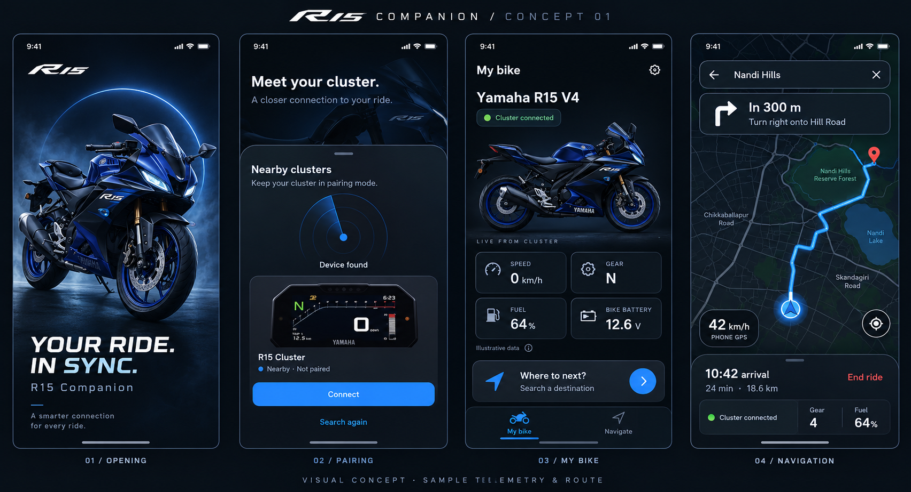

# Approved companion visual direction

Approved by the user: 2026-10-30. Status: design baseline, not implemented UI.

This board is the visual authority for the next mobile implementation. Reference apps supplied by the user are inspiration only. Preserve the board's composition, hierarchy, restrained electric-blue accent, near-black surfaces, bike artwork prominence and compact overlays. Do not introduce a competing redesign while implementing. This approval authorizes planning; implementation starts on the user's next instruction.

## Design rules

- Use near-black navy surfaces, fine slate borders, white primary text, muted secondary text and restrained blue actions. Green communicates confirmed connection; red is reserved for relevant errors and the End ride action.
- Centralize colors, spacing, typography, corner radii, icon sizes, motion and elevation in typed theme tokens. Exact values and mobile geometry are measured and frozen in the first implementation stage, rather than inferred independently in each screen.
- Retain bundled Inter and Chakra Petch branding. Use an approved consistent bike illustration family. Generated lettering, badges and the speedometer pictured on the board are illustrative; use the real app wordmark and an accurate rectangular cluster illustration in final assets. Final assets require review before use.
- The board is a dark-mode baseline. Provide a deliberately matched daylight variant and system appearance support; do not simply invert screenshots. Platform safe areas, readable text scaling, contrast and touch targets take priority over copying a bitmap's flaws.
- Default Home contains only My bike and Navigate destinations. Do not add speculative garage, service, social or account screens.
- Match the approved appearance with responsive Flutter widgets, not a full-screen screenshot. A map provider's required attribution remains visible even though it is absent from the conceptual artwork.

## Screens and states

### Opening

Large sportbike hero, restrained pulse halo and bold YOUR RIDE. IN SYNC. typography. This is a brief Flutter opening animation, separate from the native OS launch screen and the cluster's two-second boot. Retain the existing 900 ms branding duration initially; no fake percentage or indefinite wait for pairing. Reduced motion uses a still composition. Returning users proceed to Home with honest reconnect status; first-time users proceed to setup.

### First-time setup and pairing

Meet your cluster background with a rounded modal bottom sheet. Radar animates only during a bounded scan, stops when scanning ends, and respects reduced motion. Found results show a landscape rectangular HMI illustration, stable display name, Not paired state and Connect action. Discovery is not bonding or application authorization.

Selecting Connect leads to a separate matching-code/approval state before any connected claim. Preserve explicit cancellation, rejection, timeout and retry. Cover empty results, unsupported radio, disabled Bluetooth, denied/revoked permission, wrong peer, saved device, unavailable service and failed trust storage. Saved devices reconnect without repeating first-time onboarding. Disconnect preserves trust; Forget requires confirmation and visible partial-failure handling.

### My bike

Bike name and confirmed connection status above a prominent bike illustration. A reusable 2 x 2 telemetry section initially presents speed, gear, fuel and bike battery voltage, followed by the Where to next card and the two-destination navigation bar. Fields are independent, quality-bearing observations with units and source. Unsupported/unavailable/stale values show an explicit placeholder/status; connected does not mean telemetry is supported. Bike battery voltage is distinct from phone battery.

The board's 0 km/h, N, 64% and 12.6 V are design samples only. Current firmware/app contracts do not provide all these readings to the phone. Development fixtures are explicitly labelled and isolated from the normal app. Home remains usable when disconnected and during reconnection; do not repeatedly force onboarding after link loss.

### Navigation

One destination leads through search/results, destination detail and route overview before Start ride. The overview fits the full route and shows route duration, distance and estimated arrival. Active navigation follows position, shows the next maneuver at the top and keeps the compact trip/cluster sheet at the bottom. Recenter, route overview, stop confirmation and rerouting are explicit actions/states. The full-route overview and the following-camera view are separate camera modes.

Show surrounding roads, route path and moving position. Distinguish PHONE GPS speed from bike speed. GPS loss/low accuracy stops a live-position claim; stale bike data is independent of GPS quality. Cover denied location, approximate location, no fix, offline/no route, search failure, reroute cancellation, link loss, stale route generations and unsupported projection. Audio stays on the phone/headset.

“Google map type” describes the interaction, not an approved vendor. Provider selection must establish Android/iOS support, search/routing, data rights, attribution, cost and the separately permitted path to the embedded display. A phone map alone does not fulfill cluster projection. Do not forward a provider's rendered tiles or pixels without permitted support.

## Fidelity and motion acceptance

Use a 390 x 844 logical-pixel dark reference composition derived from the board. Save deterministic screen captures and reviewed golden baselines for opening, scanning, discovered, approval, Home, route overview and active navigation. Fix time, fixture data and animation phase for comparisons. Compare hierarchy, bike crop, spacing, typography, card geometry, map overlays and colors side by side; record justified accessibility/platform differences. Text and final artwork must be sharper and more accurate than the generated board.

Also inspect 320 x 568, a larger Android phone, 2x text, light mode, reduced motion, keyboard-open search, system insets and all unavailable/permission states. Validate Android on the user's phone; validate iOS separately on macOS/Xcode and an iPhone. Golden tests supplement actual visual review.

Profile on the physical Android device in profile mode after each animation/map milestone. Target smooth 60 Hz presentation where the device supports it (about 16.7 ms frame budget), without claiming an unmeasured guarantee. Record build/device, UI/raster frame percentiles, jank, memory and test duration. Restrict rebuilds to changed values, isolate map repainting, stop hidden animations and cancel subscriptions. Use bounded caches, throttled/coalesced observations and decoded artwork sized for display. Add isolates or caching only when profiling justifies them.
